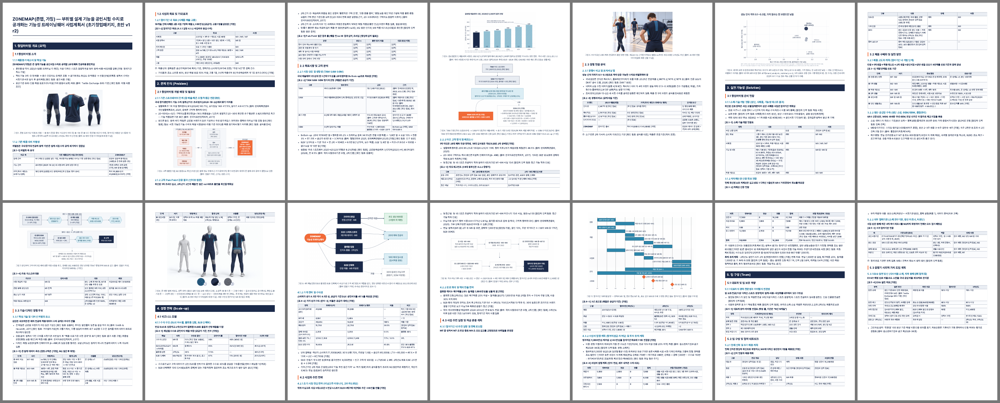

# 샘플: 기능성 스포츠웨어 신사업 사업계획서

자료와 기준을 넣어 둔 프로젝트 폴더 하나에서, 하네스로 꾸린 에이전트 팀이 초기창업패키지 사업계획서 초안을 만든 기록입니다. [실습 가이드](https://simmany.github.io/ai-project-template/practice-guide.html)의 1단계(폴더로 맡긴다)와 2단계(팀을 꾸린다)를 다른 주제로 해 본 것에 해당하며, 3단계(비서 에이전트)는 들어 있지 않습니다. 사업 아이템 'ZONEMAP(존맵, 가칭)'은 실습용으로 만든 가상의 아이템이고, 초안의 수치는 검증되지 않았습니다. 템플릿 소개는 저장소의 [README](../../README.md)에 있습니다.

## 결과물 먼저 보기



- [사업계획서_초안_v1_제출용.pdf](final/output/01_사업계획서_초안/drafts/사업계획서_초안_v1_제출용.pdf) (14쪽)
- [사업계획서_초안_v1_제출용.html](final/output/01_사업계획서_초안/drafts/사업계획서_초안_v1_제출용.html) (그림이 파일 안에 들어 있습니다)
- [사업계획서_초안_v1_제출용.md](final/output/01_사업계획서_초안/drafts/사업계획서_초안_v1_제출용.md)

HTML은 내려받아 브라우저로 엽니다(GitHub은 HTML 파일을 화면으로 보여 주지 않습니다). PDF는 GitHub 화면에서 열리지 않으면 내려받아 엽니다.

## 폴더 구성

```
new-biz-proposal/
├── scaffold/               시작 폴더: 자료와 기준만 넣어 둔 상태
│   ├── CLAUDE.md           목표와 지시 (Objective, Context, Instruction)
│   ├── context/            자료 12개
│   ├── custom-instruction/ 사업계획서 목차.txt, 작가 페르소나.txt
│   ├── workflow/           2026-10-22_REQ-001.md
│   └── output/             비어 있음
└── final/                  팀을 꾸려 초안을 만든 뒤의 상태에서 추린 것
    ├── CLAUDE.md           scaffold의 것 아래에 하네스 기록이 붙음
    ├── .claude/            agents/ 팀원 7명, skills/ 스킬 8개
    └── output/01_사업계획서_초안/
        ├── drafts/         결과물
        ├── assets/         차트, 도해, 일러스트
        ├── reviews/        심사검토보고서_v1.md
        └── _workspace/v1/  팀의 중간 산출물
```

## 따라 해 보기

폴더를 열어 주는 방법은 실습 가이드 1-4, harness 설치는 2-2를 따릅니다. 여기서는 이 샘플에서 달라지는 것만 적습니다. 아래 순서는 이 샘플을 만든 방법을 지금 실습 가이드의 표현으로 옮긴 것이며, 공개용으로 추린 뒤에 다시 실행해 확인하지는 않았습니다.

저장소 첫 화면의 Code, Download ZIP 순서로 저장소 전체를 받으면 이 폴더가 함께 들어 있습니다. 릴리스의 `ai-project-template_v1.6.zip`에는 샘플이 들어 있지 않습니다.

### 1. 프로젝트 폴더를 준비한다

`scaffold/`를 복사해 이름을 바꿔 씁니다. 내 일로 바꾸려면 `context/`에 이 일의 자료를, `custom-instruction/`에 매번 지킬 기준(이 샘플에서는 목차와 작가 페르소나)을 넣고, `CLAUDE.md`의 Objective(이루려는 것), Context(읽을 자료와 기준), Instruction(무엇을 어떻게 만들지)을 고칩니다.

Claude Code는 시작할 때 `CLAUDE.md`를 읽습니다. 이 샘플에는 `AGENTS.md`가 없으므로 Codex나 업무 에이전트에서는 첫 요청의 첫 줄에 "CLAUDE.md를 먼저 읽고 시작해줘."를 넣습니다. 가이드가 "AGENTS.md를 먼저 읽고 시작해줘."를 넣는 것과 같은 방식입니다.

`scaffold/CLAUDE.md`는 "프로젝트 스킬 중 GPT Image 스킬"로 일러스트를 만들라고 지시하지만, `scaffold/`에는 그 스킬이 없습니다.

- 일러스트까지 만들려면 `final/.claude/skills/gpt-image2/`를 내 프로젝트 폴더의 `.claude/skills/` 아래에 복사하고, 프로젝트 폴더 맨 위 `.env` 파일에 자기 OpenAI API 키를 `OPENAI_API_KEY=...` 한 줄로 넣습니다. API 사용료가 듭니다. 스크립트는 `uv`로 실행됩니다.
- 쓰지 않으려면 `CLAUDE.md`의 Instruction에서 일러스트 항목(첫 항목과 그 아래 두 줄)을 지우고 시작합니다.
- `.env`는 다른 사람에게 주거나 공개 저장소에 올리지 않습니다.

### 2. 업무 에이전트 하나에게 맡긴다

가이드 1-4의 도구(Claude 데스크톱 앱, ChatGPT Work, Claude Code, Codex) 가운데 하나로 폴더를 열고 보냅니다.

```
CLAUDE.md를 먼저 읽고 시작해줘.
사업계획서 초안을 작성해줘.
```

### 3. 하네스로 에이전트 팀을 꾸려 맡긴다

`final/`은 이 방법으로 만들었습니다. 카카오 황민호 수석이 만든 Harness v2(revfactory/harness)는 도메인 설명을 에이전트 팀과 그 팀이 쓸 스킬로 바꿔 주는 Claude Code 플러그인입니다. 순서가 중요합니다. 1에서 준비한 폴더가 팀 구성의 재료가 되므로, 폴더를 먼저 채우고 하네스를 부릅니다.

Claude Code에서 폴더를 열고 harness를 설치합니다(가이드 2-1, 2-2). 터미널이 낯설면 Claude 데스크톱 앱의 Code 탭에서 열어도 됩니다. 실제로 보낸 요청은 `scaffold/workflow/2026-10-22_REQ-001.md`에 그대로 있습니다.

```
/harness 사업계획서 초안 작성
```

- 플러그인으로 설치했다면 명령 이름이 다를 수 있습니다. 입력창에 `/`를 쳐서 보이는 `/harness:` 항목을 쓰거나, 요청에 "하네스 구성해줘"를 넣습니다(가이드 5).
- "팀원별 역할과 작업 순서를 먼저 제안하고, 내가 확인한 뒤 작업을 시작해줘."를 덧붙이면 가이드 2-5처럼 제안을 먼저 확인할 수 있습니다. 2-4의 나머지 줄은 `AGENTS.md`, `input/`, `rules/`가 있는 지금 템플릿용이라 이 샘플에서는 쓰지 않습니다.
- 팀은 사용량이 큽니다. harness 저장소의 안내는 멀티 에이전트 실행이 작업 하나에 수만에서 수십만 토큰을 쓸 수 있다고 적고 있습니다.
- Codex용으로 옮긴 저장소는 커뮤니티에 여러 개 있고 설치와 호출 방법이 서로 다르니, 쓰려는 저장소의 안내를 따릅니다(가이드 2단계 'Codex를 쓴다면'). Harness v2와 같은 계정에 올라와 있는 revfactory/codex-harness(저장소가 붙인 이름은 Harness for Codex)가 그 가운데 하나입니다.
- 만들어 둔 팀을 골라 쓰는 다른 길로 AI 워크스페이스 표준(5throck/ai-workspace-standards)이 있습니다(가이드 2B).

## 팀이 일한 과정 읽기

- [`final/CLAUDE.md`](final/CLAUDE.md) 아래쪽: 하네스 기록(호출 조건, 변경 이력). 변경 이력에 첫 실행에서 부딪힌 문제와 고친 내용이 있습니다.
- `final/.claude/agents/`: 팀원 7명. 자료 분석가, 데이터 분석가, 집필가, 평가위원, 팩트체커, 도해 디자이너, 일러스트레이터.
- `final/.claude/skills/`: 스킬 8개. `bizplan-orchestrator`가 대표 에이전트가 팀을 이끄는 오케스트레이터 스킬이고, `gpt-image2`는 하네스를 부르기 전에 넣어 둔 이미지 생성 스킬입니다.
- `final/output/01_사업계획서_초안/`: `drafts/`(결과물), `assets/`(차트 10개, 도해 18개의 mmd와 png, 일러스트 7개), `reviews/심사검토보고서_v1.md`.
- `_workspace/v1/`: 팀의 중간 산출물. 파일 이름 앞 번호가 작업 순서입니다. 01 팩트 시트와 데이터 분석, 02 집필 라운드 r0~r3, 03 평가위원·팩트체커 검토와 일러스트(샷 리스트, 자산 목록), 04 대표 에이전트(leader)의 검토 병합, 05 확정본, 06 도해 작성과 차트 보완, 07 확정 캡션과 `07_qa/`의 쪽 그림. [`run_meta.md`](final/output/01_사업계획서_초안/_workspace/v1/run_meta.md)에 실행 요약이 있습니다.

## 지금 템플릿(v1.6)과의 대응

| 이 샘플 | 지금 템플릿(v1.6) |
| --- | --- |
| `context/` | `input/` (기초자료) |
| `custom-instruction/` | `rules/` (작업규칙) |
| `workflow/` | `workflow/` (같음. 단, 샘플의 요청(REQ) 파일에는 요청 한 줄만 있고 응답 기록(AI Response)이 없음) |
| `output/` | `output/` (같음) |
| `CLAUDE.md`: 이 프로젝트의 목표와 지시 | 일하는 법은 `AGENTS.md`에(`CLAUDE.md`는 `@AGENTS.md` 한 줄), 목표와 지시는 `workflow/`의 요청(REQ) 파일의 `# Objective`, `# Context`, `# Instruction`에 |
| `output/01_사업계획서_초안/_workspace/v1/` | `_workspace/drafts/` 아래 요청(REQ)별 폴더 |
| 없음 | 작업노트 `_workspace/memory/status.md`, `AGENTS.md`, `PERSONAL-AGENT.md` |

이 대응대로 지금 템플릿에 옮겨 다시 만들어 보지는 않았습니다.

## 원본에서 뺀 것

공개하면서 API 키가 든 `.env`, 시험 조립본 폴더(`_workspace/v1/04_trial_r1`, `04_trial_r2`, 125MB), 겹치는 판(제출용이 아닌 일반판과 docx, v1b의 html·pdf), 자료에서 뽑아 둔 글과 쪽 그림(`_workspace/v1/00_extract`), harness와 evolve 스킬의 사본(원 저장소에서 설치), 실행 찌꺼기(`__pycache__`)를 뺐습니다. `final/`에는 `scaffold/`와 같은 `context/`, `custom-instruction/`, `workflow/`를 다시 넣지 않았습니다. 그래서 `final/`은 그대로 실행하는 폴더가 아니라 읽어 보는 기록이고, 직접 해 보려면 `scaffold/`에서 시작합니다.

`scaffold/`는 원본 그대로이며 두 가지만 다릅니다. 빈 `output/` 폴더가 저장소에 남도록 `.gitkeep`을 넣었고, `context/`의 PDF 두 개((3.1), (4.4))는 문서 속성의 작성자 이름만 지웠습니다(본문은 같습니다).

`drafts/`에는 `사업계획서_초안_v1_제출용`의 md·html·pdf(14쪽), `사업계획서_초안_v1b_제출용.md`(v1과는 제목 줄의 판 표기와 구분선 한 줄만 다름. 프로젝트 기록은 v1b를 13쪽 완료본으로 적고 있음), 두 판의 `build_report.json`, `창업자_입력요청_v1.md`를 남겼습니다.

## 출처와 쓰임

`samples/` 폴더는 저장소의 MIT(템플릿)와 CC BY 4.0(교재와 실습 가이드) 적용 대상이 아닙니다. 살펴보고 실습하는 용도로 공개하며, `context/`의 자료는 각 원저작자와 서비스의 것입니다.

| 자료 | 내용과 출처 |
| --- | --- |
| `(1.1)애슬레저 비즈니스 모델 캔버스.pdf` | PDF 1쪽. 창업 아이템 가설을 캔버스 양식에 적은 것. 팀명·팀원·날짜 칸이 비어 있어 작성자 표기 없음. 문서 속성에는 양식의 제목(Lean Canvas Template PPT)이 남아 있음 |
| `(2.1)논문 - 라이프 스타일이 애슬레저 웨어 제품추구혜택과 제품구매의도에 미치는 영향 연구 19_6_06(17-161)p.723-735.pdf` | PDF 13쪽. 김세나·정혜정·오경화(2017). 라이프 스타일이 애슬레저 웨어 제품추구혜택과 제품구매의도에 미치는 영향 연구. 한국의류산업학회지 19(6), 723-735. https://doi.org/10.5805/SFTI.2017.19.6.723 . 논문에 CC BY 3.0(https://creativecommons.org/licenses/by/3.0/) 공개 표기가 있음 |
| `(3.1)유튜브 리뷰 - 본격 스포츠 웨어 비교 영상(젝시믹스 안다르 나이키 룰루레몬).pdf` | PDF 4쪽. 브랜드 비교 영상의 요약문과 화면 캡처. 원 영상의 주소·채널·게시일은 파일에 없음 |
| `(3.2)마인드맵 - 기능성 스포츠웨어의 경쟁사 상황.png` | PNG 1장. 작성 도구와 날짜 표기 없음 |
| `(4.1)STORM - Current Status of the Athleisure Market.pdf` | PDF 9쪽(영문). Stanford의 STORM(storm.genie.stanford.edu)으로 만든 AI 리서치 보고서 |
| `(4.2)Genspark  - 한국 애슬레저 시장 경쟁 업체 동향 분석.pdf`, `(4.3)Genspark  - 한국 애슬레저 시장의 경쟁 업체 동향.pdf` | PDF 각 2쪽. Genspark(genspark.ai) 결과 페이지를 인쇄한 것. 페이지 표기 2025-03-04, 인쇄일 2025-03-06 |
| `(4.4)ChatGPT DeepResearch - 한국 애슬레저 시장 현황 및 최근 3년 성장 트렌드.pdf` | PDF 15쪽. ChatGPT 심층 리서치 보고서(파일 이름 기준) |
| `(4.5)ChatGPT - athleisure_market_complete_report.pdf`, `(4.5)athleisure_market_data.csv` | PDF 6쪽과 CSV. ChatGPT로 만든 보고서와 그 표 데이터(파일 이름 기준). CSV에 출처 표기 없음. 샘플의 데이터 분석 기록(`01_data-analyst_insights.md`)은 이 CSV를 예시·합성 데이터로 보고 차트로 쓰지 않음 |
| `(4.6)네이버API - brand_analysis_summary.csv` | 고객군·브랜드별 가격·성능·브랜드 점수 요약(파일 이름에 네이버API). 수집·점수 산출 방법은 파일에 없음 |
| `(5.1)애슬레저_신규사업_시장_진입_전략_최종보고서.pdf` | PDF 5쪽. 데이터 분석 결과로 진입 전략을 정리한 보고서. 본문에 작성 주체·도구 표기 없음 |

- AI 리서치 도구가 만든 자료의 수치는 원출처와 대조되지 않은 것이 많고, 샘플의 팩트 시트도 그렇게 등급을 매기고 있습니다(예: `01_analyst-market_facts.md`). 사업계획서의 수치를 실제 근거로 쓰지 마세요.
- 일러스트는 AI로 만든 컨셉 이미지이며 실제 제품이 아닙니다.
